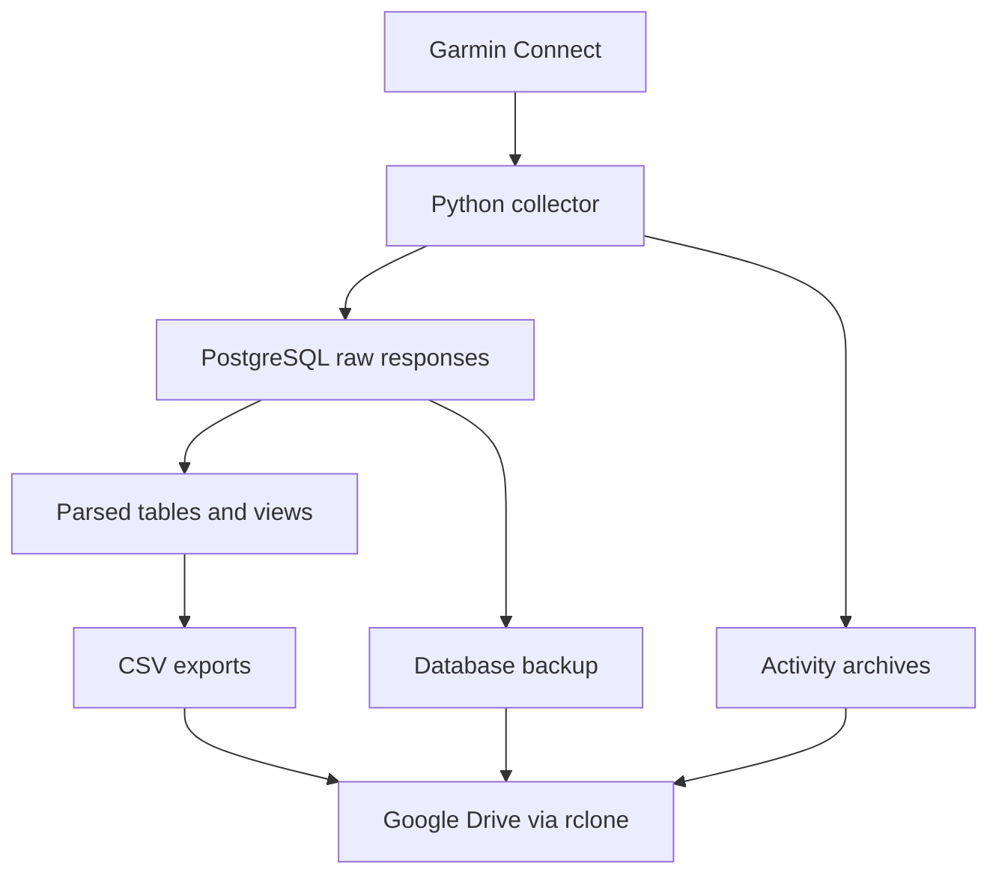

# Application architecture and operation

This document describes the code imported as v2 and its English translation. Planned credential
setup and reliability fixes are tracked in [ROADMAP.md](../ROADMAP.md); they are not implemented yet.

## Purpose and boundaries

The application collects one Garmin account's data into PostgreSQL, derives analysis tables,
exports CSV files, downloads activity archives, and copies output and database backups to Google Drive.
There is no web UI, HTTP API, multi-user account management, training recommendation engine,
or Google Drive-to-database import. Google Drive is an output destination, not the database.
A successful file upload does not prove that all Garmin requests succeeded.



The normal collector writes raw responses and parsed rows together. The raw-to-parsed arrow
also represents the explicit offline `--reparse` operation. `pg_dump` backs up the entire
database, including raw and parsed schemas and checkpoints.

## Repository map

| Path | Responsibility |
|---|---|
| `docker-compose.yml` | PostgreSQL and collector services, environment, mounts, readiness check |
| `collector/Dockerfile` | Python 3.12 image; installs PostgreSQL client, rclone, CA certificates, Python packages |
| `collector/requirements.txt` | `garminconnect`, `psycopg[binary]`, `tzdata`, and currently unused `pydantic` dependency |
| `collector/sync.py` | Configuration, schema, authentication, collection, parsing, persistence, export, backup, scheduling |
| `db/init.sql` | First-time creation of the `raw` and `garmin` schemas |
| `.env.example` | Configuration template; contains no working credentials |
| `.gitignore` | Excludes local credentials, collected output, logs, and backups |
| `docs/DATABASE.md` | All table columns, constraints, relationships, and view definitions |
| `docs/ENDPOINTS_AND_EXPORTS.md` | Exact input methods and export queries |

## PostgreSQL creation and persistence

1. Compose starts `postgres:16` with database `garmin`, user `garmin`, and password from `PG_PASSWORD`.
   On an empty `pgdata` volume, the image initializes the PostgreSQL cluster and creates the configured
   role and database. Existing volumes retain their database and credentials; editing `.env` alone
   does not reset an existing database password.
2. The named volume `pgdata` is mounted at `/var/lib/postgresql/data`. The host port is bound to
   `127.0.0.1:5432`; the collector connects over the Compose network to `postgres:5432`.
3. Only during initialization of an empty volume, PostgreSQL runs the mounted `db/init.sql`.
   That file creates two schemas; it does not define the application tables.
4. `pg_isready -U garmin -d garmin` is the service health check (10-second interval, 5-second timeout,
   10 retries). Compose waits for it before starting the collector. It is a readiness check,
   not an end-to-end authentication or data-integrity check.
5. After Garmin login, each `run_once()` connects with `PG_DSN`, sets the session time zone to
   `Europe/Moscow`, and calls `ensure_schema()`. `--reparse` also calls it; `--login` does not.
6. `ensure_schema()` executes `SCHEMA_SQL` and commits it. This creates 23 tables, one explicit
   secondary index, and two views. Tables use `CREATE TABLE IF NOT EXISTS`; views are dropped and
   recreated. This is not a general migration system: an existing table's missing columns or
   changed types are not automatically reconciled.
7. Legacy handling moves `public.raw_daily` to `raw.daily` if the destination does not exist,
   and moves `public.daily_metrics` and `public.sync_state` into `legacy`. It does not delete
   them. Existing incompatible tables or conflicting legacy names can make schema setup fail.

Rebuilding the collector does not erase the database volume. Removing that volume destroys the
local database, so normal updates must retain it. The code does not automatically restore backups.

### Current first-time setup

Docker with Compose must already be installed. Choose a database password and configure the
Drive remote yourself; the interactive all-in-one setup in the roadmap is not available yet.

```bash
cp .env.example .env
# Edit .env: set PG_PASSWORD and RCLONE_REMOTE, and optionally the history/schedule settings.
docker compose up -d postgres
# Configure a Google Drive remote named gdrive; configuration persists in ./rclone.
docker compose run --rm --no-deps collector rclone config
# Log into Garmin interactively; authentication persists in ./tokens.
docker compose run --rm collector python sync.py --login
docker compose up -d --build collector
docker compose logs --tail=100 collector
```

The browser-based OAuth step used by rclone may need to be completed on another machine on a
headless server. Use the authorization instructions printed by the installed rclone version.
`RCLONE_REMOTE=gdrive:` targets the remote root; use the intended remote folder for exports.
The collector constructs its PostgreSQL URI by interpolation: URI-reserved characters in the
password require appropriate URI encoding. The current setup does not handle this automatically.

### Persistent mounts

| Host / volume | Collector or database path | Contents |
|---|---|---|
| `pgdata` | `/var/lib/postgresql/data` | PostgreSQL cluster |
| `./tokens` | `/tokens` | Garmin authentication tokens |
| `./rclone` | `/config/rclone` | rclone remote configuration and OAuth access |
| `./out` | `/out` | CSV exports and downloaded activity archives |
| `./dumps` | `/dumps` | Compressed database dumps |
| `./logs` | `/logs` | `sync.log` |

These are filesystem mounts, not encrypted credential storage. There is currently no application
wizard for setting file permissions, replacing credentials, or disconnecting an account.

## Configuration

Values are read at process startup. Restart the collector after changing them.

| Variable | Default / source | Behavior |
|---|---|---|
| `PG_PASSWORD` | User sets it in `.env` | PostgreSQL initialization password and collector DSN interpolation |
| `PG_DSN` | Compose constructs it | Collector connection URI |
| `TZ` | `Europe/Moscow` | Collector dates, scheduling, log timestamps, aware-timestamp CSV conversion |
| `RUN_TIMES` | `09:00,22:00` | Comma-separated local `HH:MM` schedule |
| `RUN_ON_START` | `1` | Run immediately on service start when exactly `1` |
| `BACKFILL_FROM` | Empty | Candidate history start date on first sync |
| `BACKFILL_DAYS_DEFAULT` | `90` | Fallback when no raw history or explicit date exists |
| `RESYNC_DAYS` | `3` | Number of days subtracted from checkpoint; range through today is inclusive |
| `RCLONE_REMOTE` | Empty in code/Compose; example uses `gdrive:` | Destination remote; empty means skip Drive upload |
| `KEEP_DUMPS` | `14` | Local retention is a file count; remote retention is an age in days |
| `DOWNLOAD_FIT` | `1` | Download activity archives when exactly `1` |
| `OUT_DIR` | `/out` | Code-level override; not forwarded by the current Compose file |
| `DUMPS_DIR` | `/dumps` | Code-level override; not forwarded by the current Compose file |
| `LOG_FILE` | `/logs/sync.log` | Code-level override; not forwarded by the current Compose file |

The token directory is fixed at `/tokens`. Input validation is limited: malformed numeric settings,
time zones, dates, empty/invalid schedules, and nonpositive retention values are not comprehensively
validated. Code-level overrides require adding container environment settings explicitly.
Dependencies specify minimum versions rather than a lockfile; rebuilding may change installed versions.

## Authentication

`login(False)` creates `Garmin()` and attempts to load saved tokens from `/tokens`.
Failure logs a request for interactive login and exits. In service mode `safe_run()` catches that
exit and waits for the next scheduled run. It does not request credentials automatically.

`--login` first tries the same saved tokens. If they fail, it asks for email, uses `getpass()` for
the password, asks for MFA when required, logs in, and attempts to save tokens through `garth.dump()`.
That final save exception is suppressed, so the success message alone does not verify persistence.
The password is not written to source code or an application password file.
Google Drive access is handled separately by rclone's saved configuration.

## Complete sync run

`run_once()` performs these steps in order:

1. Log into Garmin and create the API wrapper.
2. Open PostgreSQL and ensure the schema.
3. Synchronize daily responses and parsed daily/intraday tables.
4. If daily sync returns True, synchronize activities and optionally download original files.
5. Regenerate all 13 CSV exports, including after a handled rate-limit interruption.
6. Close the database connection, log Garmin call count and elapsed collection/export time.
7. Create a database backup, then upload output and the backup with rclone.

Activity sync's boolean return is not checked by `run_once()`. Unhandled database, parsing, file,
or subprocess exceptions abort the remaining steps; service mode logs the exception and waits.
The reported run duration is logged before backup/upload and does not include them.
There is no cross-process lock: a manual run can overlap the scheduled service.

## History windows and checkpoints

There are independent `days_done_until` and `activities_done_until` entries in `garmin.sync_state`.
A checkpoint stores an ISO date as text. `set_state()` uses `GREATEST` so an existing checkpoint
cannot move backwards through this helper.

Without a checkpoint, history starts at the earlier of the earliest date in `raw.daily` and
`BACKFILL_FROM`, when present. Otherwise it starts at today minus `BACKFILL_DAYS_DEFAULT`.
The date range includes both endpoints: a default of 90 therefore spans 91 calendar dates.
With a checkpoint, start is `min(checkpoint, today) - RESYNC_DAYS`. A checkpoint at today and
`RESYNC_DAYS=3` yields four calendar dates, not three. `BACKFILL_FROM` is not reapplied once a
checkpoint exists. No dedicated reset/backfill command exists.

### Daily sync

`fetch_day()` calls the 16 methods listed in [ENDPOINTS_AND_EXPORTS.md](ENDPOINTS_AND_EXPORTS.md).
`parse_day()` derives seven daily rows and seven sample collections. `save_day()` upserts raw
and derived data and commits; advancing the checkpoint is a separate commit.
An interruption between those commits causes the day to be retried.

The generic upsert replaces non-key columns on conflict. Fully empty daily metric rows are skipped,
but partially populated rows can replace existing values with NULL. Intraday rows are upserted by
timestamp; old intervals are not cleared before reloading a day.

### Activity sync

The collector calls `get_activities_by_date(start, today)` and sorts the returned list by local
start time. Pagination is delegated to the installed library. It loads the set of known activity
IDs from PostgreSQL. A known activity older than today minus `RESYNC_DAYS` is skipped, regardless
of whether its child data or archive is complete.

For eligible activities, fetch summary, laps, heart rate zones, optional sets, and detail samples.
`save_activity()` stores non-None raw responses and the activity summary. For each child source:
None preserves existing rows; any available result replaces that activity's corresponding child rows,
including clearing them when parsing produces an empty list. Commit, optionally download the archive,
and advance the checkpoint. After the loop, set the activity checkpoint to today.
No reconciliation removes activities deleted from Garmin.

## Parsing and units

- Helpers perform numeric rounding, recursive key lookup, and fallback selection. Zero is retained
  as a value. Missing values generally become NULL, not inferred measurements.
- Daily body measurements come from `totalAverage`, falling back to the last weight-bearing entry
  in `dateWeightList`. Weight, muscle mass, and bone mass use grams-to-kilograms conversion.
- Training readiness uses the latest entry by its timestamp string. VO2 max, training status,
  hydration, respiration, and other metrics are taken from the selected Garmin fields.
- Invalid/nonpositive heart rate and respiration sample values and negative stress/Body Battery
  values are filtered. Timestamp duplicates within selected sample collections are collapsed.
- Sleep activity levels are mapped as 0=deep, 1=light, 2=REM, 3=awake. Original numeric level is retained.
- Activity summary fields prefer list data, then `summaryDTO` fallbacks. The activity date is taken
  from local start time. Detail descriptors map metric names to array indexes.
- For strength sets, the exercise with the highest probability is selected; its category is used
  when a name is absent. Set weights use the current ambiguous threshold rule: divide by 1000
  only when absolute value is at least 1000. This needs a separate fix.
- Unix timestamps are interpreted as milliseconds. GMT strings are interpreted as UTC. The current
  string parser truncates fractional seconds and can discard an offset suffix following them;
  `gmt_to_ts()` assigns UTC rather than converting an existing offset. Mixed formats need care.
- Durations are seconds, distance/elevation are meters, speed is meters/second, power is watts,
  energy is kcal, and HRV is milliseconds. Cadence is not normalized across activity types.

See [DATABASE.md](DATABASE.md) for every stored field and its unit.

## Transactions, uniqueness, and data recovery

Primary keys prevent duplicate records with the same defined key, not duplicate real-world events
with different Garmin IDs/timestamps. Child activity rows have cascading foreign keys; daily/raw
relationships are logical rather than enforced by foreign keys. The application is single-account.

A day/activity save is committed separately; an entire multi-day run is not one atomic transaction.
`--reparse` loads stored raw daily/activity responses, groups them by day/ID, writes derived rows in
one transaction, commits, and exports CSV. It does not query Garmin, reset checkpoints, download FIT,
back up the database, or upload to Drive. It uses the same upsert/replacement logic and does not clear
all derived tables first. It cannot reconstruct responses that were never collected or were overwritten.

## CSV files, activity archives, and Drive transfer

CSV queries are listed exactly in [ENDPOINTS_AND_EXPORTS.md](ENDPOINTS_AND_EXPORTS.md).
Each export uses `fetchall()`, writes a temporary `.tmp` file, and atomically replaces that CSV.
This protects each file individually; the full set is not an atomic snapshot. Memory usage grows
with the history size, especially for intraday/activity samples.

`download_fit()` skips an archive only when both its database record and local file exist.
It requests the ORIGINAL format if the library exposes that enum, otherwise uses the library default.
The bytes are saved with a `.zip` name containing date, ID, and activity type. The collector does not
validate archive format or contents. It records filename and size separately in `activity_files`.

`upload()` uses `rclone copy /out REMOTE`, excluding `*.tmp` and `garmin_health.json`.
It copies changed files; it does not mirror deletions. The archive folder is included in this copy.
It then uses `copyto` for the new dump and age-based `delete` within the remote `backups` folder.
Transfer failures are logged; there is no application-level immediate retry, completion manifest,
or upload checkpoint. All subprocess output is captured in memory and no timeout is configured.

## Backups and retention

`backup()` runs `pg_dump` against `PG_DSN`, pipes output to gzip, and names the dump
`garmin_YYYYMMDD_HHMM.sql.gz`. It keeps the latest `KEEP_DUMPS` local files by filename ordering.
With two runs per day, 14 local files represent roughly seven days, while remote cleanup uses 14 days.
Runs in the same minute use the same filename. The default dump includes all schemas in the database.

Current defects: the shell pipeline reports gzip's status, which can hide a pg_dump failure;
an empty dump can be accepted and older backups removed. Shell quoting of the DSN is also fragile.
No restore validation exists. The separately installed PostgreSQL client version is not pinned to 16,
and client/server compatibility must be verified on deployment.

For a deliberately chosen dump, a manual restore into a prepared database can use:

```bash
# Only target a database intentionally prepared for restoration; this is not an automatic startup step.
gzip -dc /path/to/chosen.sql.gz | docker compose exec -T postgres psql -U garmin -d garmin
```

A restore into a populated database can conflict with existing objects. Restore into an isolated
empty database and verify results before using a backup for recovery. This repository contains
no complete restore/recovery automation.

## Rate limits, errors, and scheduling

`Api.call()` waits 0.4 seconds before each supported method call. There is an additional 1.5-second
pause per daily iteration and one-second pause per loaded activity. An unavailable method is warned
once per run and returns None. Most exceptions are warned once per label/type per run and return None.
Rate limiting is recognized by the text `429` or `Too Many`; `with_rate_limit()` waits 600 seconds,
then retries once. A repeated limit stops that sync phase. Retrying a whole daily/activity fetch may
repeat earlier successful endpoint calls in that fetch.

`service()` optionally runs immediately, then chooses the earliest future local time in `RUN_TIMES`,
sleeps until it, and calls `safe_run()`. Missed scheduled times are not replayed. `safe_run()` catches
login exits and other ordinary exceptions. There is no external cron requirement, health endpoint,
alert notification, log rotation, or watchdog for stale data. Both Compose services use
`restart: unless-stopped` for process/container exits.

### Known failure cases still present

| Trigger | Current result | Planned correction |
|---|---|---|
| Daily endpoint fails | A None response can overwrite a saved raw payload; partial derived rows can lose values | Preserve previously collected data and distinguish unavailable responses |
| Activity-list request fails | None becomes an empty list and checkpoint advances to today | Keep the checkpoint until retrieval succeeds |
| Old activity is known but incomplete | Skipped outside the recent window | Retry incomplete child data/files |
| Garmin changes intraday intervals | Upsert leaves removed/replaced timestamps behind | Reconcile the relevant intervals |
| pg_dump fails but gzip succeeds | Backup can appear successful | Check producer status and validate backup before rotation |
| Source set weight is below 1000 grams | May be treated as kilograms | Verify source units and convert explicitly |

## Operational checks

```bash
# Service state and recent logs
docker compose ps
docker compose logs --tail=100 collector
tail -n 100 logs/sync.log

# Current checkpoints and stored date range
docker compose exec postgres psql -U garmin -d garmin -c 'TABLE garmin.sync_state;'
docker compose exec postgres psql -U garmin -d garmin -c 'SELECT min(day), max(day), count(DISTINCT day) FROM raw.daily;'
docker compose exec postgres psql -U garmin -d garmin -c 'SELECT min(day), max(day), count(*) FROM garmin.activities;'

# Manual sync; avoid overlap with a scheduled run
docker compose run --rm collector python sync.py --once

# Rebuild derived tables locally from saved responses
docker compose run --rm collector python sync.py --reparse
```

Check date coverage, checkpoint movement, endpoint warnings, archive readability, and restoreability
of backups. File modification time alone is not evidence that data is complete. Database checks above
are operational examples; documentation work did not run them against the production server.
