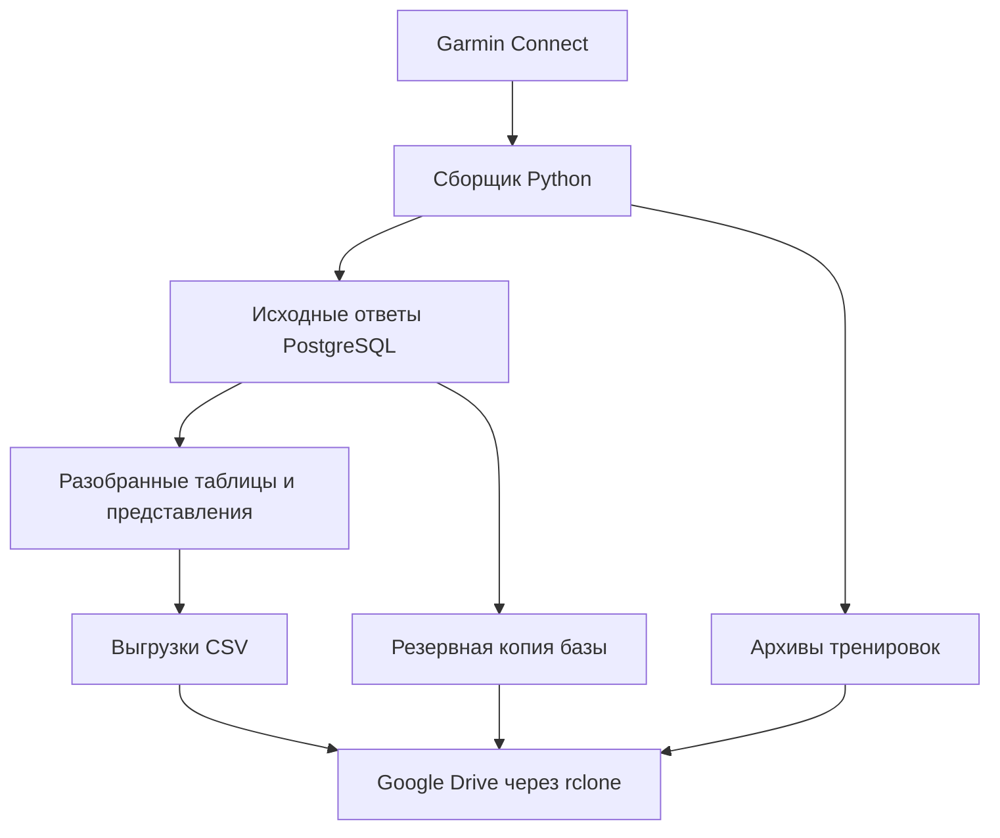

# Архитектура и работа приложения

[English](../ARCHITECTURE.md) | Русский

Документ описывает текущую v2 после перевода текстов на английский. Мастер настройки и
исправления надёжности из [плана](../../ROADMAP.ru.md) пока не реализованы.

## Назначение и границы

Приложение собирает данные одного аккаунта Garmin в PostgreSQL, формирует таблицы для анализа,
выгружает CSV, скачивает архивы тренировок и копирует результаты вместе с резервными копиями
базы в Google Drive. Работает в Docker на локальном компьютере или сервере.

Веб-интерфейса, HTTP API, управления несколькими пользователями, рекомендаций по тренировкам
и импорта с Google Drive в базу нет. Google Drive — место выгрузки, а не основная база.
Успешная загрузка файла не подтверждает успешность всех запросов Garmin.



Обычно сборщик записывает исходные ответы и разобранные строки вместе. Стрелка от исходных
ответов к таблицам также обозначает автономную пересборку `--reparse`. Дамп `pg_dump`
содержит всю базу: исходные и разобранные данные, а также контрольные даты синхронизации.

## Структура проекта

| Путь | Назначение |
|---|---|
| `docker-compose.yml` | Сервисы PostgreSQL и сборщика, переменные, тома, проверка готовности |
| `collector/Dockerfile` | Образ Python 3.12, клиент PostgreSQL, rclone, сертификаты и пакеты Python |
| `collector/requirements.txt` | `garminconnect`, `psycopg[binary]`, `tzdata`, а также пока не используемый `pydantic` |
| `collector/sync.py` | Настройки, схема, вход, сбор, разбор, запись, выгрузка, бэкапы, расписание |
| `db/init.sql` | Первоначальное создание схем `raw` и `garmin` |
| `.env.example` | Шаблон настроек без действующих доступов |
| `.gitignore` | Исключение доступов, выгрузок, журналов и резервных копий из Git |
| `docs/ru/DATABASE.md` | Все поля, ограничения, связи и SQL представлений |
| `docs/ru/ENDPOINTS_AND_EXPORTS.md` | Методы получения данных и запросы выгрузок |

## Создание PostgreSQL и сохранность базы

1. Compose запускает `postgres:16`: база `garmin`, пользователь `garmin`, пароль из `PG_PASSWORD`.
   При пустом томе `pgdata` образ создаёт кластер PostgreSQL, роль и базу. Существующий том
   сохраняет данные и пароль; редактирование `.env` само по себе пароль в базе не меняет.
2. Именованный том `pgdata` подключён к `/var/lib/postgresql/data`. Порт хоста привязан только
   к `127.0.0.1:5432`; сборщик подключается внутри сети Compose к `postgres:5432`.
3. Только при инициализации пустого тома выполняется `db/init.sql`. Он создаёт две схемы,
   но не таблицы приложения.
4. Проверка готовности — `pg_isready -U garmin -d garmin`: интервал 10 секунд, тайм-аут
   5 секунд, 10 попыток. Compose ждёт готовности перед запуском сборщика. Это не проверка
   корректности авторизации и полноты данных приложения.
5. После входа в Garmin каждый `run_once()` подключается через `PG_DSN`, задаёт сессии
   часовой пояс `Europe/Moscow` и вызывает `ensure_schema()`. `--reparse` тоже создаёт схему,
   а `--login` не обращается к базе.
6. `ensure_schema()` выполняет и фиксирует `SCHEMA_SQL`: 23 таблицы, один явный дополнительный
   индекс, два представления. Таблицы используют `CREATE TABLE IF NOT EXISTS`, представления
   удаляются и создаются заново. Полноценного механизма миграций нет: отсутствующие столбцы
   и изменённые типы уже существующих таблиц автоматически не исправляются.
7. Старый `public.raw_daily` переносится в `raw.daily`, если новой таблицы ещё нет.
   `public.daily_metrics` и `public.sync_state` переносятся в `legacy`, а не удаляются.
   Несовместимые таблицы и конфликты имён в `legacy` могут остановить создание схемы.

Пересборка сборщика не удаляет том базы. Удаление `pgdata` уничтожает локальную базу,
поэтому при обновлениях том сохраняют. Автоматического восстановления из бэкапа нет.

### Текущая первоначальная настройка

Docker с Compose должен быть установлен заранее. Пароль базы и remote Google Drive
пользователь настраивает самостоятельно; общий интерактивный мастер пока есть только в плане.

```bash
cp .env.example .env
# В .env задайте PG_PASSWORD, RCLONE_REMOTE и при необходимости историю/расписание.
docker compose up -d postgres
# Создайте remote Google Drive с именем gdrive; настройки останутся в ./rclone.
docker compose run --rm --no-deps collector rclone config
# Войдите в Garmin; токены останутся в ./tokens.
docker compose run --rm collector python sync.py --login
docker compose up -d --build collector
docker compose logs --tail=100 collector
```

На сервере без графического интерфейса браузерную OAuth-авторизацию rclone может потребоваться
завершить на другом компьютере. Следуйте инструкциям установленной версии rclone.
`RCLONE_REMOTE=gdrive:` указывает корень remote; задавайте нужную папку назначения.
URI подключения к PostgreSQL составляется подстановкой пароля: специальные символы URI
требуют подходящего кодирования. Текущая настройка не делает это автоматически.

### Постоянное хранилище

| Том / каталог хоста | Путь в контейнере | Содержимое |
|---|---|---|
| `pgdata` | `/var/lib/postgresql/data` | Кластер PostgreSQL |
| `./tokens` | `/tokens` | Токены Garmin |
| `./rclone` | `/config/rclone` | Remote и OAuth-доступ rclone |
| `./out` | `/out` | CSV и архивы тренировок |
| `./dumps` | `/dumps` | Сжатые дампы базы |
| `./logs` | `/logs` | `sync.log` |

Это обычные файловые подключения, а не зашифрованное хранилище секретов. Мастера назначения
прав на файлы, замены доступов и отключения аккаунтов пока нет.

## Настройки

Значения читаются при старте процесса; после изменения нужно перезапустить сборщик.

| Переменная | Значение по умолчанию / источник | Назначение |
|---|---|---|
| `PG_PASSWORD` | Вводится в `.env` | Пароль первоначального создания PostgreSQL и подстановки в DSN |
| `PG_DSN` | Составляется Compose | URI подключения сборщика |
| `TZ` | `Europe/Moscow` | Даты, расписание, журнал, перевод времени с часовым поясом при выгрузке |
| `RUN_TIMES` | `09:00,22:00` | Местное время запусков, список `HH:MM` через запятую |
| `RUN_ON_START` | `1` | Немедленный проход при старте, если значение ровно `1` |
| `BACKFILL_FROM` | Пусто | Возможная начальная дата первой загрузки |
| `BACKFILL_DAYS_DEFAULT` | `90` | Глубина истории при отсутствии данных и явной даты |
| `RESYNC_DAYS` | `3` | Вычитается из контрольной даты; диапазон до сегодня включителен |
| `RCLONE_REMOTE` | Пусто в коде/Compose, `gdrive:` в примере | Место выгрузки; пустое значение отключает отправку на Диск |
| `KEEP_DUMPS` | `14` | Число локальных файлов; возраст удаляемых удалённых копий в днях |
| `DOWNLOAD_FIT` | `1` | Скачивание архивов, если значение ровно `1` |
| `OUT_DIR` | `/out` | Переопределение в коде; текущий Compose его не передаёт |
| `DUMPS_DIR` | `/dumps` | Переопределение в коде; текущий Compose его не передаёт |
| `LOG_FILE` | `/logs/sync.log` | Переопределение в коде; текущий Compose его не передаёт |

Каталог токенов фиксирован: `/tokens`. Проверка вводимых значений ограничена: нет полной
валидации чисел, дат, часовых поясов, пустого/неверного расписания и неположительного срока
хранения. Для кодовых переопределений нужно явно добавить переменные контейнера.
Пакеты задаются минимальными версиями без lock-файла; пересборка может изменить версии.

## Авторизация

`login(False)` создаёт `Garmin()` и пытается загрузить токены из `/tokens`. Если вход не удался,
выводит просьбу войти интерактивно и завершает выполнение. В режиме службы `safe_run()`
перехватывает выход и ждёт следующего запуска; автоматического запроса пароля нет.

`--login` сначала тоже пробует сохранённые токены. При неудаче спрашивает email, пароль через
`getpass()`, MFA при необходимости и выполняет вход. Затем пытается сохранить токены через
`garth.dump()`. Ошибка этого сохранения подавляется, поэтому сообщение об успехе само по себе
не доказывает сохранность токенов. Пароль не записывается в исходники или отдельный файл пароля.
Доступом Google Drive отдельно управляет rclone через свою конфигурацию.

## Полный проход

`run_once()` выполняет операции последовательно:

1. Вход в Garmin и создание обёртки API.
2. Подключение PostgreSQL и создание схемы.
3. Синхронизация суточных ответов и разобранных суточных/внутридневных таблиц.
4. Если суточный этап вернул True — синхронизация тренировок и при необходимости файлов.
5. Пересоздание всех 13 CSV, в том числе после обработанного ограничения частоты запросов.
6. Закрытие подключения к базе; запись числа запросов и времени сбора/выгрузки.
7. Создание бэкапа, затем копирование результатов и бэкапа через rclone.

Булев результат этапа тренировок не проверяется. Необработанные ошибки базы, разбора, файлов
и подпроцессов прерывают остальные действия; служба пишет ошибку и ждёт следующего запуска.
Время прохода в журнале не включает бэкап и отправку. Межпроцессной блокировки нет:
ручной проход может пересечься с запуском по расписанию.

## История и контрольные даты

В `garmin.sync_state` независимо хранятся `days_done_until` и `activities_done_until`.
Это даты строкой ISO; `set_state()` использует `GREATEST`, поэтому не сдвигает значение назад.

Если контрольной даты нет, выбирается более ранняя из первой даты в `raw.daily` и
`BACKFILL_FROM`, когда они заданы. Иначе начало — сегодня минус `BACKFILL_DAYS_DEFAULT`.
Обе границы включены: значение 90 даёт 91 календарную дату. При существующей контрольной
дате начало равно `min(контрольная дата, сегодня) - RESYNC_DAYS`. Если контрольная дата —
сегодня, значение 3 даёт четыре даты. После появления контрольной даты `BACKFILL_FROM`
повторно не применяется. Отдельной команды сброса или повторной загрузки истории нет.

### Суточные данные

`fetch_day()` вызывает 16 методов из [перечня запросов](ENDPOINTS_AND_EXPORTS.md).
`parse_day()` формирует семь суточных строк и семь наборов измерений.
`save_day()` записывает исходные и разобранные данные через upsert и фиксирует транзакцию.
Продвижение контрольной даты фиксируется отдельно; сбой между фиксациями приводит к повтору даты.

При конфликте ключа upsert заменяет остальные поля. Полностью пустые суточные строки
пропускаются, частично заполненные могут заменить старые значения на NULL.
Измерения обновляются по времени; прежние интервалы перед перечитыванием дня не очищаются.

### Тренировки

Сборщик получает `get_activities_by_date(start, today)` и сортирует результат по местному
времени начала. Разбиение ответа на страницы делегировано установленной библиотеке.
Из базы читается множество известных идентификаторов. Известная тренировка старше
сегодня минус `RESYNC_DAYS` пропускается независимо от полноты подходов, кругов и файлов.

Для выбранной тренировки запрашиваются сводка, круги, зоны, при необходимости подходы,
а также подробные измерения. `save_activity()` сохраняет ненулевые исходные ответы и сводку.
При None дочерний набор остаётся прежним. При доступном ответе соответствующие строки
тренировки удаляются и заменяются, включая полную очистку при пустом результате разбора.
После фиксации скачивается файл, если включено, затем продвигается контрольная дата.
В конце цикла контрольная дата тренировок устанавливается на сегодня.
Тренировки, удалённые в Garmin, автоматически из базы не удаляются.

## Разбор и единицы

- Вспомогательные функции округляют числа, рекурсивно ищут ключи и выбирают запасные значения.
  Ноль считается значением. Пропуски обычно становятся NULL, а не предполагаемыми измерениями.
- Показатели тела берутся из `totalAverage`, иначе из последней записи с весом в `dateWeightList`.
  Вес, мышечная и костная масса переводятся из граммов в килограммы.
- Для готовности выбирается последняя запись по строке времени. МПК, статус, вода, дыхание
  и другие показатели берутся из соответствующих полей Garmin.
- Неположительные пульс/дыхание и отрицательные стресс/Body Battery отбрасываются.
  Повторы времени внутри некоторых наборов измерений объединяются.
- Уровни сна: 0 — глубокий, 1 — лёгкий, 2 — REM, 3 — бодрствование. Исходное число сохраняется.
- В сводке тренировки приоритет имеют поля списка, затем `summaryDTO`. Дата берётся из местного
  начала. Дескрипторы подробных данных связывают имена показателей с индексами массива.
- Для подхода выбирается упражнение с максимальной вероятностью; без имени используется
  категория. Вес делится на 1000 только при абсолютном значении не меньше 1000. Это
  неоднозначное правило требует отдельного исправления.
- Unix-время трактуется как миллисекунды. Строки GMT — как UTC. Текущий парсер отбрасывает
  дробные секунды и может отбросить следующий за ними часовой сдвиг. `gmt_to_ts()` назначает
  UTC, а не переводит существующий сдвиг. Смешанные форматы требуют осторожности.
- Длительность — секунды, расстояние/высота — метры, скорость — м/с, мощность — Вт,
  энергия — ккал, HRV — мс. Каденс между типами тренировок не нормализуется.

Все сохраняемые поля и единицы приведены в [справочнике базы](DATABASE.md).

## Транзакции, уникальность и пересборка

Первичные ключи предотвращают повторы одного ключа, но не одного события с разными ID или
временем Garmin. Дочерние таблицы тренировок имеют внешние ключи с каскадным удалением;
связи остальных таблиц логические. Экземпляр приложения рассчитан на один аккаунт.

Каждый день или тренировка фиксируются отдельно; весь многодневный проход не является единой
атомарной транзакцией. `--reparse` загружает сохранённые исходные ответы, группирует их по
датам/ID, записывает разобранные данные одной транзакцией, фиксирует и выгружает CSV.
Garmin не опрашивается, контрольные даты не сбрасываются, FIT не скачивается, бэкап и отправка
на Диск не выполняются. Применяются те же правила upsert/замены, без предварительной очистки
всех таблиц. Несобранные или затёртые исходные ответы так восстановить нельзя.

## CSV, архивы и отправка на Диск

Точные запросы перечислены в [документе о выгрузках](ENDPOINTS_AND_EXPORTS.md).
Для каждого CSV выполняется `fetchall()`, пишется временный `.tmp`, затем файл атомарно
заменяется. Атомарность действует для отдельного файла; набор CSV не является единым снимком.
Потребление памяти растёт с историей, особенно для подробных измерений.

`download_fit()` пропускает скачивание только при наличии и записи в базе, и локального файла.
Если библиотека предоставляет enum ORIGINAL, используется он; иначе формат библиотеки
по умолчанию. Байты записываются с расширением `.zip`, именем из даты, ID и типа тренировки.
Формат и содержимое архива не проверяются. Имя и размер записываются в `activity_files`.

`upload()` выполняет `rclone copy /out REMOTE`, исключая `*.tmp` и `garmin_health.json`.
Копируются изменившиеся файлы, включая папку архивов; удалённые локально файлы не удаляются
на Диске. Новый дамп отправляется через `copyto`, затем в папке `backups` выполняется
удаление по возрасту. Ошибки пишутся в журнал; немедленного повтора на уровне приложения,
реестра завершённой выгрузки и отдельной контрольной даты отправки нет.
Вывод подпроцессов собирается в памяти; тайм-аут не установлен.

## Резервные копии и хранение

`backup()` запускает `pg_dump` по `PG_DSN`, передаёт результат в gzip и создаёт
`garmin_YYYYMMDD_HHMM.sql.gz`. По сортировке имён сохраняет последние `KEEP_DUMPS` локальных
файлов. При двух проходах в день 14 файлов — примерно семь дней, но удалённая очистка
использует 14 дней. Два запуска в одну минуту используют одно имя. Дамп охватывает все схемы базы.

Текущая ошибка: код возврата конвейера отражает gzip и может скрыть отказ `pg_dump`.
Пустой дамп может быть признан успешным, после чего старые копии удалятся. Экранирование DSN
для оболочки тоже ненадёжно. Проверки восстановления нет. Версия клиента PostgreSQL
не закреплена на 16; совместимость с сервером нужно проверять при развёртывании.

Пример ручного восстановления выбранного дампа в подготовленную базу:

```bash
# Только в базу, намеренно подготовленную для восстановления. Это не шаг обычного запуска.
gzip -dc /path/to/chosen.sql.gz | docker compose exec -T postgres psql -U garmin -d garmin
```

В заполненной базе возможны конфликты объектов. Сначала восстанавливайте в отдельную пустую
базу и проверяйте результат. Полной автоматизации восстановления в репозитории нет.

## Ограничения частоты, ошибки и расписание

`Api.call()` ждёт 0,4 секунды перед поддерживаемым запросом. Дополнительно — 1,5 секунды
после дня и 1 секунда после загруженной тренировки. Отсутствующий метод даёт одно предупреждение
за проход и None. Большинство исключений тоже превращается в None с одним предупреждением
на сочетание названия операции и типа ошибки за проход. Лимит распознаётся по тексту `429`
или `Too Many`. `with_rate_limit()` ждёт 600 секунд и повторяет один раз; повторный лимит
останавливает этап. Повтор всего набора запросов дня/тренировки может снова вызвать уже
успешно выполненные методы.

`service()` при настройке выполняет немедленный проход, затем выбирает ближайшее будущее
время из `RUN_TIMES`, спит и вызывает `safe_run()`. Пропущенные запуски не воспроизводятся.
`safe_run()` перехватывает выход при неудачном входе и обычные исключения. Внешний cron
не нужен. Нет health endpoint, уведомлений, ротации журнала и контроля устаревания данных.
Оба сервиса Compose используют `restart: unless-stopped` при выходе процесса/контейнера.

### Известные неисправности

| Событие | Текущее поведение | Запланированное исправление |
|---|---|---|
| Ошибка суточного запроса | None может затереть исходный ответ; частичная строка — старые значения | Сохранять прежние данные, отличать недоступный ответ |
| Ошибка списка тренировок | None превращается в пустой список, контрольная дата становится сегодняшней | Продвигать дату только после успешного запроса |
| Старая известная тренировка неполна | Пропускается за пределами недавнего окна | Повторять недостающие данные и файлы |
| Garmin изменил внутридневные интервалы | Старые временные точки остаются | Согласовывать интервалы |
| pg_dump отказал, gzip успешен | Бэкап может считаться исправным | Проверять источник и бэкап до ротации |
| Вес подхода меньше 1000 граммов | Может считаться килограммами | Проверить единицы и преобразовывать явно |

## Проверки при эксплуатации

```bash
# Состояние и последние сообщения
docker compose ps
docker compose logs --tail=100 collector
tail -n 100 logs/sync.log

# Контрольные даты и диапазоны данных
docker compose exec postgres psql -U garmin -d garmin -c 'TABLE garmin.sync_state;'
docker compose exec postgres psql -U garmin -d garmin -c 'SELECT min(day), max(day), count(DISTINCT day) FROM raw.daily;'
docker compose exec postgres psql -U garmin -d garmin -c 'SELECT min(day), max(day), count(*) FROM garmin.activities;'

# Ручной проход: не допускать пересечения с запуском по расписанию
docker compose run --rm collector python sync.py --once

# Локальная пересборка из сохранённых ответов
docker compose run --rm collector python sync.py --reparse
```

Проверяйте покрытие дат, продвижение контрольных дат, предупреждения методов, читаемость
архивов и возможность восстановления бэкапов. Время изменения файла само по себе не доказывает
полноту данных. Команды выше — примеры для эксплуатации; при подготовке документации
они не выполнялись на рабочем сервере.
